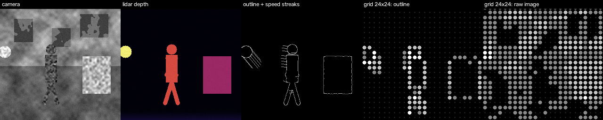
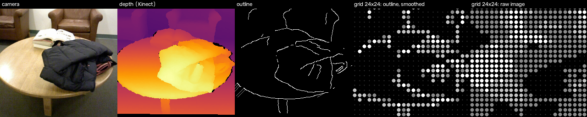

# Neura-C: outline and motion encoding for low-resolution electrotactile vision

Code for the preprint *Outline and Motion Encoding of RGB-D Scenes for Low-Resolution Electrotactile
Vision: A Simulation Study* (Amarsh N Choudhary, IIT Delhi, 2026),
[doi:10.5281/zenodo.23317774](https://doi.org/10.5281/zenodo.23317774).

The simulator turns RGB-D video into a sparse line drawing (depth outlines weighted by nearness, plus speed
streaks behind moving objects), removes the wearer's own camera motion using depth, and renders the result on a
model electrode grid (16x16 to 32x32, four intensity levels, optional temporal hysteresis).




## Files

| File | What it does |
| --- | --- |
| `scene.py` | Synthetic RGB-D scene with ground-truth labels (wall with posters, box, walking person, fast ball) |
| `encoder.py` | Depth outlines, optical-flow speed streaks, depth-hole filling, ego-motion removal (homography or depth + PnP) |
| `grid.py` | Electrode grid model, raw-image baseline, ground-truth boundaries, `GridSmoother` hysteresis |
| `run.py` | Synthetic experiment: boundary F1 and electrodes lit per grid size |
| `run_real.py` | Real RGB-D experiment: electrodes lit, flicker, spurious streaks |
| `results/` | Figures, demo GIFs and metrics reported in the paper |

## Run

```
pip install -r requirements.txt
python3 run.py                                  # synthetic scene
python3 run_real.py <sequence_dir> lounge       # folder with color/ and depth/ PNGs, depth in mm
```

The real sequence in the paper is frames 1399 to 1639 of the Open3D Lounge RGB-D sequence
([download](https://github.com/isl-org/open3d_downloads/releases/download/20220301-data/LoungeRGBDImages.zip)).

## Limitations

These are signal-level simulation results, not perceptual results. Nothing here drives stimulation hardware.

## License

MIT

## Channel experiment: can a tactile-sized grid tell objects apart?

`channel/train_channel.py` sends Fashion-MNIST objects (10 classes) through a simulated N x N electrode grid
(4 intensity levels, noise 0.05) and trains a small reader network to name the object from the grid alone.
Encoders: downsampled image, edge map, and a learned encoder trained jointly with the reader.

Object accuracy on 10,000 test images (chance 10%; same reader on the full 28 x 28 image: 86.7%):

| Grid | Raw image | Edges | Learned |
| --- | --- | --- | --- |
| 6x6 | 76.9% | 75.9% | 81.3% |
| 8x8 | 80.9% | 81.8% | 83.6% |
| 10x10 | 81.0% | 82.2% | 82.8% |
| 14x14 | 84.3% | 84.5% | 68.5% (training unstable) |
| 20x20 | 84.2% | 84.2% | 81.5% |

Run: `python3 channel/train_channel.py <fashion_mnist_dir> results/channel_results.json` (about 20 minutes on 4 CPU cores).
A neural reader is not a person, so these are upper bounds on what a trained user could extract.

### Shape-keeping encoder (`channel/train_shaped.py`, 8 training passes)

The learned encoder is also penalised for drifting from the object's own silhouette (weight alpha).
"Shape match" is the correlation between the pattern and the downsampled silhouette (1 = same shape, negative = inverted).

| Grid | Code | Accuracy | Electrodes lit | Shape match |
| --- | --- | --- | --- | --- |
| 8x8 | Downsampled image | 83.1% | 56% | 0.97 |
| 8x8 | Learned, unconstrained | 85.4% | 38% | -0.19 |
| 8x8 | Learned, shape-keeping (alpha 1) | 86.2% | 44% | 0.84 |
| 8x8 | Learned, shape-keeping (alpha 4) | 85.3% | 52% | 0.94 |
| 20x20 | Downsampled image | 86.5% | 50% | 0.97 |
| 20x20 | Learned, unconstrained | 87.4% | 43% | -0.43 |
| 20x20 | Learned, shape-keeping (alpha 4) | 88.2% | 48% | 0.94 |

`reading-test/` is a browser page that tests whether a person can name objects from the 8x8 codes.

## Citation

Amarsh N Choudhary. Outline and Motion Encoding of RGB-D Scenes for Low-Resolution Electrotactile Vision:
A Simulation Study. Zenodo preprint, 2026. https://doi.org/10.5281/zenodo.23317774
